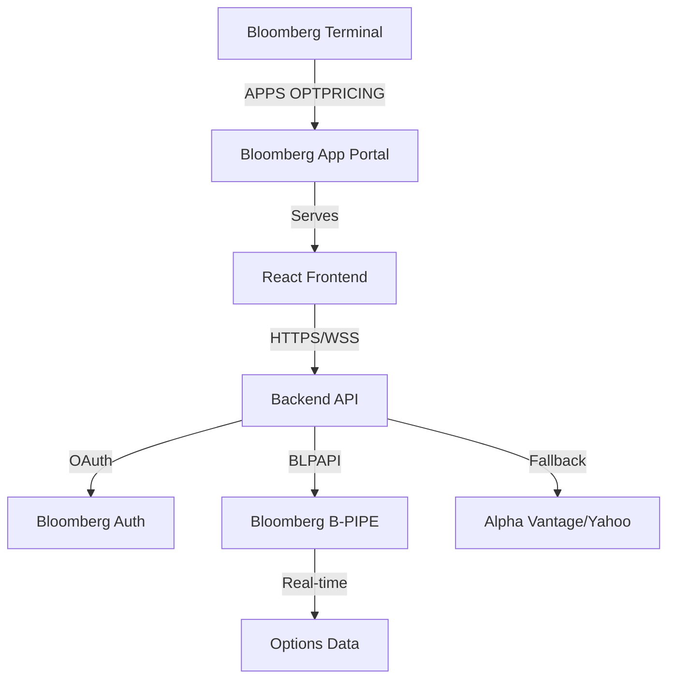

# Bloomberg Terminal Integration Plan

## Executive Summary

Transform the Options Pricing platform into a **Bloomberg App** accessible via Bloomberg Terminal's App Portal. This enables professional traders and quant analysts to access our advanced options analytics directly within their Bloomberg workspace.

---

## Integration Architecture



---

## Phase 1: Bloomberg App Portal Registration

### 1.1 Developer Account Setup
**Requirements:**
- Bloomberg Terminal subscription
- Bloomberg Developer account (register at `developer.bloomberg.com`)
- Company verification (if applicable)

**Steps:**
1. Go to `APPS <GO>` on Bloomberg Terminal
2. Select "Developer Portal"
3. Register your application:
   - **App Name**: "Options Pricing Engine"
   - **Category**: Analytics & Trading Tools
   - **Target Users**: Quant Analysts, Options Traders
   - **Description**: Advanced Black-Scholes pricing with ML signals and statistical arbitrage

### 1.2 App Manifest
Create `bloomberg-app.json`:
```json
{
  "appId": "com.optionspricing.terminal",
  "name": "Options Pricing Engine",
  "version": "1.0.0",
  "type": "web",
  "entryPoint": "https://your-domain.com",
  "permissions": [
    "MARKET_DATA",
    "REFERENCE_DATA",
    "USER_IDENTITY"
  ],
  "categories": ["derivatives", "analytics"],
  "launchCommand": "OPTPRICING"
}
```

---

## Phase 2: Bloomberg Data Integration (BLPAPI)

### 2.1 Install Bloomberg API
```bash
# Node.js Bloomberg API
bun add node-blpapi

# Or Python alternative
pip install blpapi
```

### 2.2 Options Data Fetching
Replace Yahoo Finance with Bloomberg:

```typescript
// src/bloomberg/blpapi.ts
import { Session } from 'node-blpapi';

export class BloombergDataService {
  private session: Session;

  constructor() {
    this.session = new Session({
      serverHost: 'localhost',
      serverPort: 8194,
    });
  }

  async getOptionsChain(ticker: string) {
    const security = `${ticker} US Equity`;
    const fields = ['OPT_CHAIN', 'IVOL_MID', 'DELTA', 'GAMMA'];

    const data = await this.session.refData([security], fields);
    return data;
  }

  async getHistoricalVolatility(ticker: string, days: number = 30) {
    const security = `${ticker} US Equity`;
    const fields = ['PX_LAST', 'HISTORICAL_VOLATILITY_30D'];

    return await this.session.historicalData(security, fields, days);
  }
}
```

### 2.3 Real-Time Subscriptions
```typescript
async subscribeToQuotes(tickers: string[], callback: Function) {
  const securities = tickers.map(t => `${t} US Equity`);
  const fields = ['LAST_PRICE', 'BID', 'ASK', 'VOLUME'];

  this.session.subscribe(securities, fields, (data) => {
    callback(data);
  });
}
```

---

## Phase 3: Bloomberg-Style UI Theme

### 3.1 Color Scheme
Bloomberg's professional aesthetic:

```typescript
// tailwind.config.js - Bloomberg Theme
colors: {
  'bloomberg-orange': '#FF6600',
  'bloomberg-dark': '#0A0A0A',
  'bloomberg-gray': '#1A1A1A',
  'bloomberg-text': '#FFFFFF',
  'bloomberg-accent': '#FFB84D',
  'alert-green': '#00FF00',
  'alert-red': '#FF0000',
}
```

### 3.2 Bloomberg Component Library
```typescript
// Components matching Bloomberg's design
export const BloombergCard = ({ title, children }) => (
  <div className="bg-bloomberg-gray border-l-4 border-bloomberg-orange p-4">
    <h3 className="text-bloomberg-orange font-mono text-sm mb-2">
      {title.toUpperCase()}
    </h3>
    <div className="text-bloomberg-text font-mono text-xs">
      {children}
    </div>
  </div>
);
```

---

## Phase 4: Authentication & Security

### 4.1 Bloomberg SSO
```typescript
// Middleware for Bloomberg authentication
app.use('/api', async (req, res, next) => {
  const bbgToken = req.headers['x-bloomberg-token'];

  if (!bbgToken) {
    return res.status(401).json({ error: 'Bloomberg auth required' });
  }

  const user = await verifyBloombergToken(bbgToken);
  req.user = user;
  next();
});
```

### 4.2 Audit Logging
Required for Bloomberg compliance:

```typescript
// Log all API calls
function auditLog(userId: string, action: string, data: any) {
  const log = {
    timestamp: new Date().toISOString(),
    userId,
    action,
    data,
    ipAddress: req.ip,
  };

  // Store in secure audit database
  await db.auditLogs.insert(log);
}
```

---

## Phase 5: Deployment Architecture

### 5.1 Production Infrastructure
**Recommended Stack:**
- **Frontend**: Vercel / AWS CloudFront
- **Backend**: AWS ECS / Google Cloud Run
- **Database**: PostgreSQL (RDS) + Redis
- **CDN**: CloudFlare for global distribution

### 5.2 High Availability
```yaml
# docker-compose.yml for production
services:
  api:
    image: options-pricing-api:latest
    replicas: 3
    environment:
      - BLOOMBERG_HOST=localhost:8194
      - REDIS_URL=redis://cache:6379
    healthcheck:
      test: ["CMD", "curl", "-f", "http://localhost:3001/health"]
      interval: 30s

  cache:
    image: redis:7-alpine

  db:
    image: postgres:15-alpine
```

---

## Phase 6: Testing & Certification

### 6.1 Bloomberg UAT Environment
- Test in Bloomberg's sandbox environment
- Verify data accuracy against Bloomberg's models
- Performance testing: <100ms response time
- Stress testing: 10,000 concurrent users

### 6.2 Certification Requirements
Bloomberg's checklist:
- [ ] Security audit passed
- [ ] Data accuracy verified (±0.1% of Bloomberg's prices)
- [ ] UI/UX meets Bloomberg standards
- [ ] Documentation complete
- [ ] Support contact provided

---

## Phase 7: Monetization Strategy

Since this is a Bloomberg App:

**Option 1: Subscription**
- $99/month per user
- Enterprise: $999/month (unlimited users)
- Bloomberg takes 30% revenue share

**Option 2: Freemium**
- Basic features free
- Advanced features (ML signals, stat arb) paid
- Institutional licensing

**Option 3: White Label**
- License to hedge funds/prop shops
- Custom branding
- On-premise deployment

---

## Development Roadmap

### Week 1-2: Core Integration
- [ ] Register Bloomberg developer account
- [ ] Install BLPAPI SDK
- [ ] Create Bloomberg data adapters
- [ ] Implement authentication

### Week 3-4: UI Redesign
- [ ] Bloomberg color scheme
- [ ] Professional terminal aesthetic
- [ ] Font matching (Bloomberg uses FF Mark)
- [ ] Keyboard shortcuts (Bloomberg-style)

### Week 5-6: Testing
- [ ] UAT environment testing
- [ ] Performance optimization
- [ ] Security audit
- [ ] Documentation

### Week 7-8: Deployment
- [ ] Production infrastructure setup
- [ ] Bloomberg App Portal submission
- [ ] Beta testing with users
- [ ] Official launch

---

## Cost Estimates

**Infrastructure (Monthly):**
- AWS/GCP hosting: $200-$500
- Bloomberg B-PIPE: $2,000-$5,000
- Database: $100
- CDN: $50
- **Total**: ~$2,500-$5,500/month

**Development:**
- Bloomberg integration: 40-80 hours
- UI redesign: 20-40 hours
- Testing: 20 hours
- **Total**: 80-140 hours

---

## Competitive Advantage

**Why This Stands Out:**
1. **First-mover**: Few custom options analytics apps on Bloomberg
2. **Professional**: Enterprise-grade architecture
3. **Advanced**: ML signals + stat arb is unique
4. **Institutional**: Appeals to hedge funds, prop shops
5. **Portfolio**: Shows you can build Bloomberg-level tools

---

## Next Steps

1. **Immediate**: Register Bloomberg developer account
2. **Short-term**: Redesign UI with Bloomberg theme
3. **Medium-term**: Integrate BLPAPI for real data
4. **Long-term**: Deploy to Bloomberg App Portal

This positions you perfectly for roles at firms like:
- Citadel Securities
- Jane Street
- Two Sigma
- Goldman Sachs Strats
- Bloomberg LP itself!
